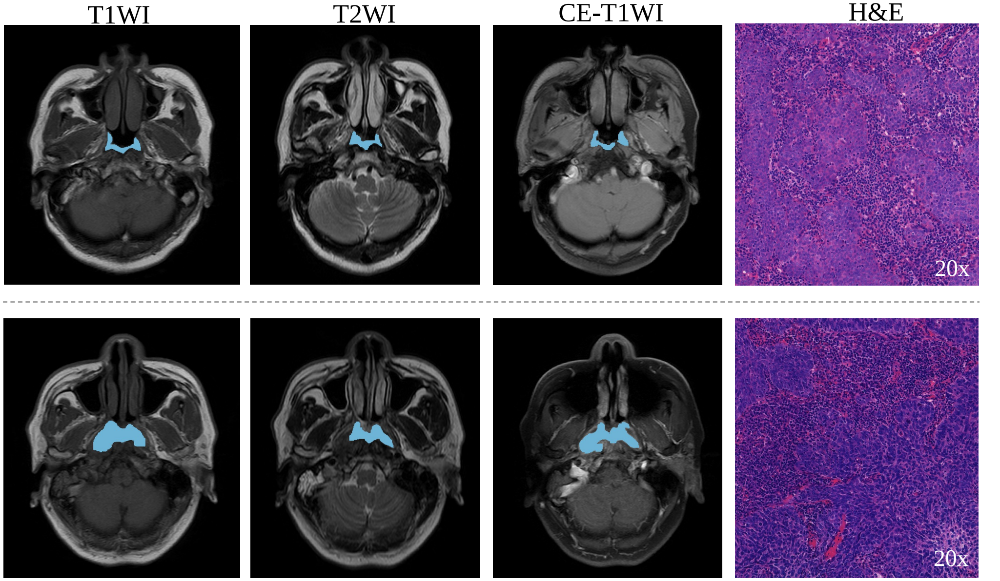
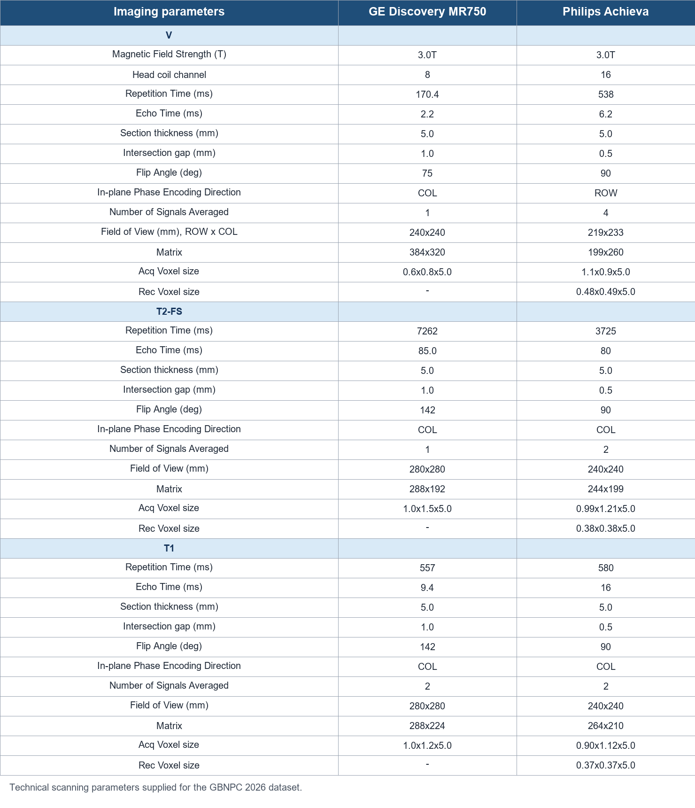
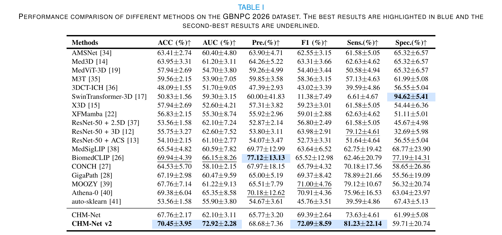
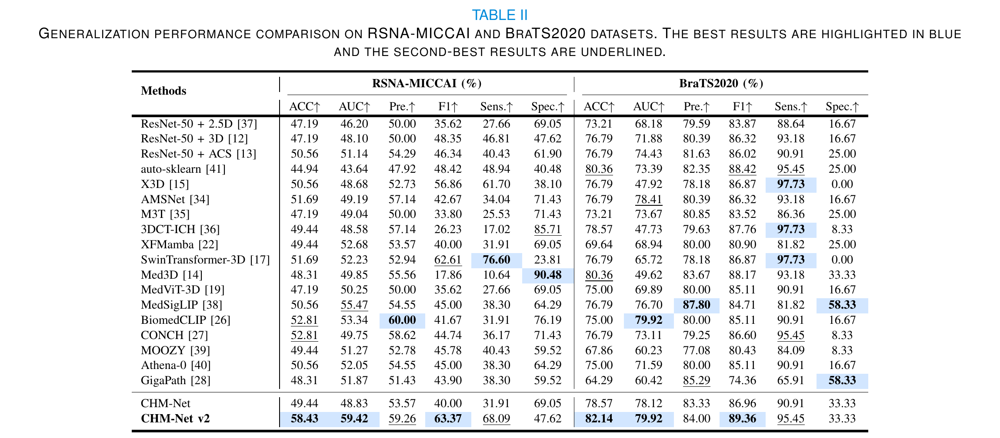
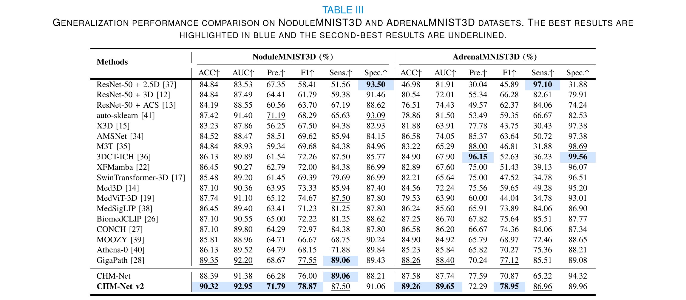
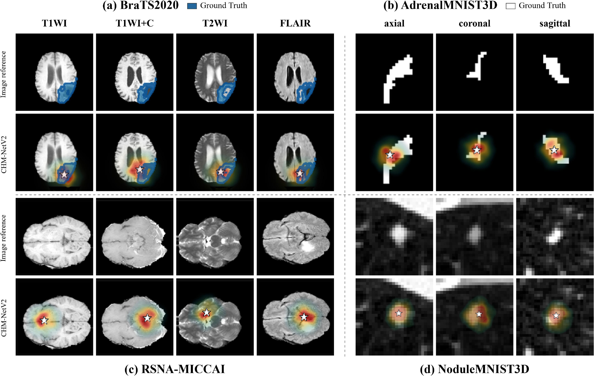

# CHM-Net V2

CHM-Net V2 studies patient-level microbial-density classification with MRI and H&E-derived pathology information. The manuscript also evaluates transfer to four public 3D medical imaging benchmarks.

## Data Description

### Nasopharyngeal Carcinoma MRI and H&E: GBNPC 2026

- **Modalities:** MRI and H&E histopathology
- **Size:** 183 3D volumes
- **Five-fold split sizes:** 37 / 37 / 37 / 36 / 36
- **Sequences:** T1-weighted imaging (T1WI), T2-weighted imaging (T2WI), and contrast-enhanced T1-weighted imaging (CE-T1WI)

GBNPC 2026 contains multi-sequence nasopharyngeal MRI scans with professional tumor annotations and corresponding hematoxylin and eosin (H&E)-stained histopathology images. The figure shows representative patients with low (upper row) and high (lower row) intratumoral microbial density. From left to right, each row presents T1WI, T2WI, CE-T1WI, and the corresponding H&E image at 20x magnification.

The technical scanning parameters are summarized below.

**Inclusion criteria:** histopathologically confirmed nasopharyngeal carcinoma; preoperative MRI acquired within two weeks before surgery; no history of other malignancies.

**Exclusion criterion:** suboptimal image quality.

For the public benchmark description, see [`docs/dataset.md`](docs/dataset.md).

## Experiments

Performance comparisons from the manuscript. Best results are highlighted in blue; second-best results are underlined.

### GBNPC 2026

### RSNA-MICCAI and BraTS2020

### NoduleMNIST3D and AdrenalMNIST3D

## Visual Comparisons

Visualization results on four public 3D medical imaging datasets. Blue and white regions denote ground-truth lesion masks, stars indicate localized high-response centers, and red regions denote heatmap responses.

