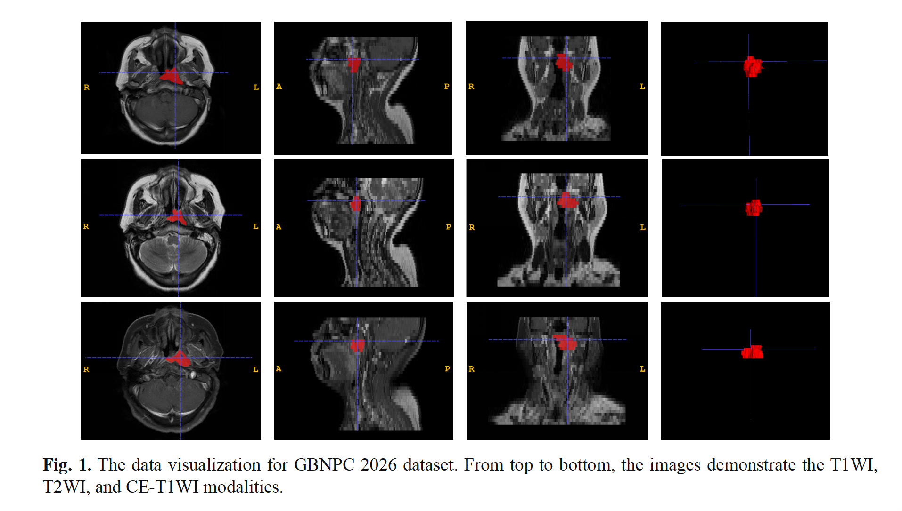
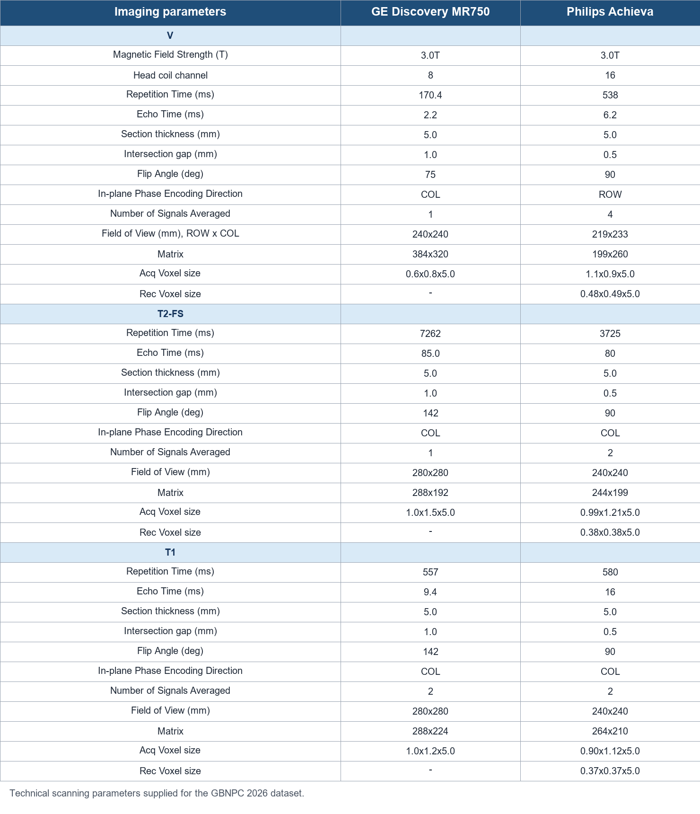

# Data Description

## Nasopharyngeal Carcinoma MRI: GBNPC 2026

**Modality:** MRI

**Size:** 183 3D volumes

**Five-fold split sizes:** 37 / 37 / 37 / 36 / 36

GBNPC 2026 includes three types of nasopharyngeal MRI scans with professional tumor annotations: T1-weighted imaging (T1WI), T2-weighted imaging (T2WI), and contrast-enhanced T1-weighted imaging (CE-T1WI).

The technical scanning parameters for the dataset are summarized in the following table.

**Inclusion criteria:** (a) histopathologically confirmed nasopharyngeal carcinoma; (b) preoperative MRI within two weeks before surgery; and (c) no history of other malignancies.

**Exclusion criterion:** suboptimal image quality.

## Public Dataset: NoduleMNIST3D

NoduleMNIST3D is a publicly available 3D medical imaging dataset used in the CHM-Net V2 manuscript to evaluate transfer to a CT classification task.

- **Modality:** 3D computed tomography (CT)
- **Task:** binary classification of lung nodules as benign or malignant
- **Samples:** 1,633, as reported in the manuscript
- **Source:** [MedMNIST](https://medmnist.com/)
- **Use in the study:** independent evaluation of cross-task and cross-modality transfer

Download the dataset through the official MedMNIST distribution and follow its current access terms, software instructions, and citation requirements. This repository does not mirror the dataset.

## Citation

The manuscript cites the MedMNIST v2 paper for the public benchmark datasets:

> J. Yang et al., "MedMNIST v2: A large-scale lightweight benchmark for 2D and 3D biomedical image classification," *Scientific Data*, vol. 10, article 41, 2023. [doi:10.1038/s41597-022-01721-8](https://doi.org/10.1038/s41597-022-01721-8).

Please also check MedMNIST's current documentation for dataset-specific citation guidance.
